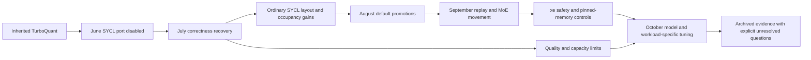

# What progressed: capability, performance, and confidence

The fork progressed from a broken SYCL TurboQuant port to a broader Intel
inference stack with useful cache layouts, attention scheduling, fusion,
memory-movement controls and speculative decoding. That is demonstrable from
the history. A single cumulative throughput improvement from divergence to
today is not demonstrable: the model, prompt, cache, routing, compiler, driver
and memory placement change between campaigns.

Read [March-August measurements](07-performance-early.md) and
[September-October measurements](08-performance-late.md) for the detailed
tables. The [Hindsight crosswalk](09-hindsight-crosswalk.md) adds observations
between commits and exposes stale recollections. The [dead-end register](11-dead-ends-and-open-questions.md)
states exactly what a new benchmark, static review or recovered artifact could
resolve. The original [master ledger](05-master-ledger.md) remains the complete
commit sequence; these chapters map behavior onto it.

## Timeline

Dates in this table are experiment/development periods. Commit anchors identify
retained implementations or integrations, not necessarily the exact experimental
binary. Author, committer and archive-import dates must remain distinct.

| Period | Capability progression | Performance or quality evidence | Retained history anchors |
| --- | --- | --- | --- |
| March-April inherited development | Turbo KV formats, WHT, CPU/backend implementations evolve; serialized layouts are still changing | No comparable A770 longitudinal baseline established for this period | `0b3744874`; [inherited history](01-chronology.md) |
| June 25-27 | SYCL import -> rotation/indexing trouble -> explicit turbo disable | Valid ordinary f16 operation does not validate turbo; memory records stalled/garbage turbo output | `3faf37b41`, `a7696500b`, `904738505` |
| July 2-6 | FA private-Q and row-count repair; non-FA repair; wider turbo4 centroids; experimental XMX | Coherent supported completions and oracle reports make performance comparisons meaningful; XMX remains slow/guarded | `dbf32f863`, `0d518a2ec`, `f14f0ef10`, `9e43bd2a5` |
| July 7-12 | Dense-model quality/capacity characterization; asymmetric/boundary policies; partial InnerQ state flow | Turbo offers capacity, not universal speed. Early concurrency probes establish configured ceilings, not sustained parallel throughput. Source review retracts scale-fold causality | `058e536d9`, `4e8a77363`, `8b11e9f93`; [early results](07-performance-early.md) |
| July 18-26 | P5 measurement gates, per-kernel code split, q8 layout opt-in; occupancy repair; SDK and server hardening | Paired results separate retained improvements from global-GRF, direct-upload and exact-replay failures; occupancy deep-context gains are shape-specific | `77d356251`, `ba478ef9d`, `5beb6c3f3`, `5aa5c34f8` |
| August 12-16 | q8 layout and dense FFN fusion default promotions; Qwen rotation-predicate and graph-profile repairs | Later valid fusion campaign supports roughly 6-8% dense decode improvements. Qwen bad-predicate PPL 659.66 drops to 16.92, against 16.64 reference: correctness recovery | `754dc99e2`, `968b451e9`, `d74cace9a`, `ca41ef399` |
| September 3-14 | Large reconciliation, new quant formats/model work; MKL q8 layout repaired after long-context NaNs | Symmetric turbo3 quality improves but still fails a 5% gate; q8 K/turbo3 V passes at +0.54% PPL | `54d02625c`, `b1e4170ec`, `4bb688b3d` |
| September 26-28 | Redesigned graph replay, MoE cache repairs, ESIMD/grouped work, real prefetch queue | Cache execution/hit rates are functionality evidence; i915 Qwen prefetch records about +16% prefill, with corrected teardown lifetime | `52f0bca26`, `005bf5c01`, `d00df4038`, `69db254ec`, `11598778b` |
| September 29-October 1 | xe exposes mmap/blitter failures; copy-off default; pinned host controls; targeted GRF option | Pinned versus mmap same-boot pp512 325.1 -> 366.0 t/s; decode flat. Quiet tile-only GRF Llama pp512 998.4 -> 1098.3, +10.0% +/-0.9% | `beda936e7`, `5b1eb7c34`; external runtime patch tracked separately |
| October 4-5 | Qwen4Exp MTP loading/mixer/borrowed-table/rollback/fit improvements; guarded checkpoints | Real path execution and synthetic correctness expand; checkpoint +3.53% +/-3.62% is inconclusive and streams differ | `001d906a6`; [speculation evidence](08-performance-late.md) |
| October 6-7 host campaign | CCS, routing, occupancy, prompt mix and memory constraints become better understood | CCS 1 beats 2/4; MKL preference flips by measured shape; WG 32 helps deep Ornith; broader prompt mix retracts general ngram advice | Installed `b12327.c4b9d6430`; [frozen report](../benchmarks/matrix-1006/FINAL-REPORT.md), archived later |
| October 8-10 | Accepted-token observation; scheduler copy lifetime path; current upstream snapshot; durable archive | Better observability and controlled opt-in functionality, without a new scheduler speed/equivalence claim | `d09fb6ba4`, `bba3994a9`, `08d0baaca`, `2f623c660` |

The arrows describe development order, not additive performance improvement.
The detailed chapters also record regressions and paths withdrawn between these
milestones. SDK/network-free packaging, server CORS/MCP policy, backend pruning,
and quantization ABI changes are important functionality changes even where no
benchmark exists; their source-level behavior is documented in
[the upstream comparison](04-current-upstream-delta.md).

## Comparisons that can be used, with their actual denominator

`pp512` means processing a 512-token prompt block; a depth-qualified row already
has a cache/context prefix. `tg64`/`tg128` are generation benchmark cells, often
with synthetic/random tokens, and are not automatically real-text serving rates.
PPL is perplexity: lower is better within the same model/tokenizer/corpus/setup.
Capacity ceilings, KV format ratios and total VRAM usage are different quantities.

| Cohort | Baseline -> candidate | What this supports | Why it cannot be joined to another row |
| --- | --- | --- | --- |
| July P5 per-kernel split, Mistral/Llama | Cold-start latency -19.94%/-17.01%; warm pp512 +92.69%/+85.22%; warm tg128 +1.74%/+1.05% | Both startup and warm results exist in [P5.9](../research/sycl/sycl-a770-p5-performance-campaign-2026-07-19.md) | Different metrics and builds; startup percentage is not a throughput percentage |
| August dense FFN promotion | Roughly +5.7 to +7.8% decode across tested Mistral/Llama depths | Valid later campaign, distinct from invalid July fusion artifacts | Does not apply to every MoE graph, shape or later stack |
| August dense turbo4 capacity reopen, Mistral/Llama | KV allocation 1088 -> 544 MiB versus q8 at context 16384; decode +8.48%/+8.68% versus q4 at that depth, lower 95% +8.18%/+6.68% | Both models pass all six declared gates; PPL better than q4, demonstrating a successful reopening | Memory comparison uses q8, speed comparison q4; original missing July artifacts are not restored by this new campaign |
| September Llama quality policy, context 512 | q8/q8 PPL 7.9861 -> symmetric turbo3 8.3939 (+5.11%, fails); asymmetric q8/turbo3 8.0292 (+0.54%, passes) | Cache policy changes accuracy materially; nominal requested type is insufficient | Different PPL baseline from July; no cross-model or full-context quality guarantee |
| September xe pinned-vs-mmap Ornith | pp512 325.1 -> 366.0 t/s; tg64 49.2 -> 49.4 | About 12.6% prefill benefit for this placement/memory comparison | Host-memory source changes, not a quantified independent fork-code effect |
| Quiet GRF Llama q8/q8 | pp512 998.4 -> 1098.3, paired +10.0% +/-0.9% | Selected FA kernel register mode helps this short-prefill cell | Final shipping-build interval is much wider; accepted provenance is not universal performance improvement |
| October Llama MKL, depth 32768 | MKL on 63.5 -> off 103.7 t/s prefill | Off helps this measured d=128 cell | Ornith d=256 has opposite direction: on 208 -> off 118 |
| October Ornith WG 32 | Versus 16: deep decode +5.2% at 16k, +10.3% at 32k, +18.0% at 64k | Workload/depth-specific occupancy tuning | Dense 8B shows little effect; depth 0 unchanged; service setting differs from source default |
| October Ornith varied prompts | No speculation 45.4/45.3 t/s at temperatures 0/0.6; ngram-mod -0.1%/-6.2%; ngram-simple -3.3%/-2.8% | Representative tested mix favors no speculation | Individual prompt gains/losses are large; not a general theorem against drafting |
| October Qwen4Exp MTP | No spec 13.3 -> MTP 16.8 or 17.6 t/s | A useful measured MTP workload exists on A770 | Different model/placement/prompt from Ornith; report supplies no matched CI |

These values are historical reports, not freshly measured numbers. Detailed
chapters identify raw product validity, sample counts, route coverage and
confounds. In particular, no error bar is invented for a source that supplies
only a point estimate, and printed llama-bench spread is not relabeled a paired
confidence interval.

## What became more trustworthy, and what did not

The strongest progress is not only faster cells. The fork gained stronger
numerical oracles, effective-layout checks, source-aware provenance, fixed
failure gates, per-prompt speculative observations, and explicit retractions.
Those changes made it harder for unsupported success claims to survive.

They did not eliminate the problem. The archive contains invalid binary
comparisons, early missing fault logs, failures hidden by unexercised routes,
stale orientation guidance and contradictory memory. Ten of the sixteen
primary GRF products pass their archived global validation; six do not. That
distinction is more informative than treating all sixteen result files equally.

The report itself was corrected during this extension: the initial chronology
described code splitting too narrowly as a cold-start result. The retained P5
report also contains warm prefill and decode measurements, now explicitly
recorded here. Evidence review must correct its own summary when the source
is more specific.

No single conclusion should outlive its revision conditions: the pinned tree,
model, effective cache layout, shape, driver/runtime, host load and measured
execution path. Future source fixes or stack changes may reopen a dead end;
missing historical evidence stays missing until it is actually recovered.
